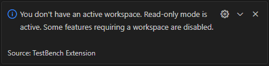

import loginWebm from './videos/login.webm';
import loginMp4 from './videos/login.mp4';
import linkTovWebm from './videos/link_tov.webm';
import linkTovMp4 from './videos/link_tov.mp4';

## 1. Open workspace and sign in

1. Open a workspace folder in VS Code.
2. Open the TestBench view from the side bar.
3. Create or select a connection and sign in.

To create a new connection, fill in the **Add New Connection** form in the TestBench view and choose **Save New Connection**:

| Field                              | Description                                                                             |
| ---------------------------------- | --------------------------------------------------------------------------------------- |
| Connection Label (Optional)        | Display name of the connection in the list of saved connections.                        |
| Server Hostname or IP Address      | Host of the TestBench server, for example `testbench.example.com`.                      |
| Port Number                        | Port of the TestBench server, for example `9443`.                                       |
| Username / Password                | Your TestBench credentials.                                                             |
| Store password for this connection | Enabled by default. Disable it if you want to enter the password each time you sign in. |

Saved connections are listed above the form. Each entry has buttons to sign in with it, edit it, or delete it. After a successful login, **Projects View** opens automatically.

<video controls preload="metadata" playsinline width="100%">
    <source src={loginWebm} type="video/webm" />
    <source src={loginMp4} type="video/mp4" />
    Your browser does not support the video tag.
</video>

## 2. Set active context from Projects View

1. In Projects View, navigate to a project.
2. Right-click the target test object version (TOV) you want to work with and choose **Set as Active TOV**.

<video controls preload="metadata" playsinline width="100%">
    <source src={linkTovWebm} type="video/webm" />
    <source src={linkTovMp4} type="video/mp4" />
    Your browser does not support the video tag.
</video>

The extension stores this TOV context in `.testbench/ls.config.json`.

## 3. Open the context you want to work with

Open either the test object version you selected as active context, or a cycle that belongs to this test object version:

- Hover over the TOV in **Projects View** and click the inline **Open Test Object Version** button.
- Hover over a cycle and click the inline **Open Test Cycle** button, or double-click the cycle.

The context you open determines the available actions:

- If you open a TOV context, test generation is available.
- If you open a cycle context, test generation and execution results upload are available.

## 4. Create resources and synchronize keywords

1. In **Test Elements View**, hover over a subdivision whose name ends with `[Robot-Resource]` and click **Create Resource**.
2. Implement the keywords in the created `.resource` file.
3. Use the CodeLens actions above the file or above a keyword to push your changes to TestBench or pull changes from TestBench.

See [Test Elements View](../views/test-elements-view.md) for details.

## 5. Generate, run, and upload

1. In **Test Themes View**, hover over a test theme or test case set and click **Generate Robot Framework Test Suites**. The suites are written to the directory configured in **outputDirectory** (default: `tests`).
2. Run the generated suites with RobotCode or another Robot Framework runner, so that the results are written to the path configured in **outputXmlFilePath** (default: `results/output.xml`).
3. If you opened a cycle, click **Upload Execution Results To TestBench** on the generated tree item.

See [Test Themes View](../views/test-themes-view.md) for details.

## Workspace behavior

- When a workspace is open, the full feature set is available.
- When no workspace is open, the extension is in read-only mode. Test generation, execution results upload, resource creation, and keyword synchronization actions that modify local files or TestBench content are unavailable.

## Next steps

- Adjust output paths and resource mapping in the [Settings Reference](../configuration/settings-reference.md).
- If something does not work as expected, see [Troubleshooting](../troubleshooting/troubleshooting.md).
