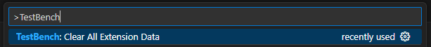

| Symptom                                                                    | Likely Cause                                                 | Resolution                                                                                                                                                                   |
| -------------------------------------------------------------------------- | ------------------------------------------------------------ | ---------------------------------------------------------------------------------------------------------------------------------------------------------------------------- |
| Extension in read-only mode                                                | No folder/workspace opened                                   | Open a workspace folder in VS Code.                                                                                                                                          |
| **Upload Execution Results To TestBench** button is missing in Test Themes | Test Themes opened from TOV instead of cycle                 | Open a cycle from Projects View; upload is cycle-context only.                                                                                                               |
| Test generation or upload skipped some selected items                      | One or more Test Theme tree items are locked by another user | Locked items are skipped by design. Check lock status/owner in TestBench, unlock (or wait until unlocked), then run the operation again.                                     |
| Uploading execution results fails                                          | `output.xml` missing or wrong path                           | Verify **outputXmlFilePath** and test runner output location.                                                                                                                |
| A file dialog opens when uploading execution results                       | No file found at the configured **outputXmlFilePath**        | Select the `output.xml` manually, or correct **outputXmlFilePath** so that it matches the test runner output location.                                                       |
| No CodeLens actions available for a resource file                          | Invalid or missing resource metadata/context                 | Ensure the correct TOV context is selected in Projects View and verify that `tb:uid` and `tb:context` exist and match the selected context.                                  |
| No CodeLens actions for a single keyword                                   | Keyword is tagged `tb:ignore` or `robot:private`             | Remove the tag if the keyword should be synchronized with TestBench.                                                                                                         |
| No CodeLens actions in any resource file                                   | No usable Python interpreter selected                        | Run **Python: Select Interpreter**, choose Python 3.10 or newer, then reload the window.                                                                                     |
| "TestBench context mismatch" shown in a resource file                      | `tb:context` differs from the active TOV                     | Select the matching TOV in Projects View, or use the Quick Fix **Apply selected TestBench context**.                                                                         |
| Pushing a keyword fails with "Element is locked in TestBench"              | Keyword is locked, for example by another user               | Unlock the keyword in TestBench, then push again.                                                                                                                            |
| "Incompatible TestBench server version" on login                           | Server version is outside the supported range                | Check [Requirements](../getting-started/installation.md#requirements). Update the extension, or install the extension version named in the message.                          |
| TLS/certificate errors                                                     | Untrusted server certificate                                 | Configure **certificatePath** or **NODE_EXTRA_CA_CERTS**. See [Certificate and TLS configuration](../configuration/settings-reference.md#certificate-and-tls-configuration). |
| Server not reachable behind a proxy                                        | Proxy not configured in VS Code                              | Set `http.proxy` (and `http.noProxy` if needed) in VS Code. See [Proxy](../configuration/settings-reference.md#proxy).                                                       |
| Unexpected redirect to login view                                          | Session could not be recovered automatically                 | Check network/server availability, then sign in again. If this persists, verify proxy/certificate settings and server reachability.                                          |

## Session keep-alive and automatic recovery

While you are logged in, the extension keeps the TestBench session alive in the background and retries temporary request failures automatically. If the session expires, it first tries to sign in again silently. Only if that fails does it log you out locally and return to the login view.

## Log files

The extension writes one log file, `.testbench/logs/testBenchExtension.log` in the workspace. Depending on the problem, other sources are more helpful:

| Source                                      | Location                                        | Use it for                                                                                                                                                           |
| ------------------------------------------- | ----------------------------------------------- | -------------------------------------------------------------------------------------------------------------------------------------------------------------------- |
| `testBenchExtension.log`                    | `.testbench/logs/` in the workspace             | Login, session and server requests, tree views, test generation, and upload of execution results. Keyword synchronization messages are prefixed `[Language server]`. |
| `testBenchExtension.log.1`, `.2`, ...       | Same folder                                     | Older entries after log rotation. See [Logging behavior](../configuration/settings-reference.md#logging-behavior).                                                   |
| **TestBench LS** output channel             | **View > Output**, then select **TestBench LS** | Language server startup failures and crashes, for example when CodeLens actions are missing in every resource file.                                                  |
| Robot Framework `log.html` and `output.xml` | Output location of your test runner             | Failures during test execution itself. These are produced by Robot Framework, not by the extension.                                                                  |

To get more detail, set **Testbench Log Level** to `Debug` or `Trace`, reproduce the problem, and attach the log file to your bug report.

If the log file is missing or empty, check the following:

- **No workspace folder is open.** The extension only writes a log file while a workspace folder is open.
- **Testbench Log Level** is set to `No logging`.
- The extension has no write permission for the `.testbench/logs` folder.

## Reset and recovery actions

### Reload Window

Use **Reload Window** when the extension UI appears out of sync, for example after connection changes, missing/disabled view actions, or stale tree content.

To run it:

1. Open the Command Palette (**Ctrl+Shift+P** / **Cmd+Shift+P**).
2. Run **Developer: Reload Window**.

### TestBench: Clear All Extension Data

Use **TestBench: Clear All Extension Data** when problems persist after a reload and you want to reset extension state.

You can trigger it from the Command Palette:

1. Open the Command Palette (**Ctrl+Shift+P** / **Cmd+Shift+P**).
2. Run **TestBench: Clear All Extension Data**.

:::warning
**Clear All Extension Data** removes persisted extension data, including stored connections. This operation cannot be undone.
:::

## Need more help?

For bug reports or feature requests, run **TestBench: Open Issue Reporter** from the Command Palette, or use the
[TestBench VS Code extension GitHub repository](https://github.com/imbus/testbench-vscode-extension).
