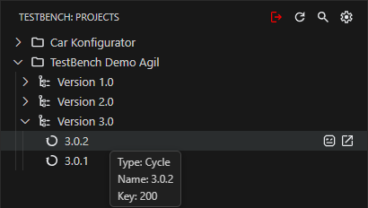
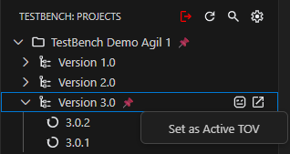

**Projects View** is the entry point for working with TestBench content in VS Code. It lets you browse projects, Test Object Versions (TOVs), and Test Cycles, and open the context used by the other views.

## Open context

Opening a TOV or a cycle loads its context into **Test Themes View** and **Test Elements View**:

- **Test Object Version**: hover over the TOV and click the inline **Open Test Object Version** button.
- **Test Cycle**: hover over the cycle and click the inline **Open Test Cycle** button, or double-click the cycle.

Open a cycle if you want to upload execution results later. Upload is not available in a TOV context.

## Set the active configuration

The active configuration links the workspace to a TestBench project and TOV. Keyword synchronization uses it to find the matching TestBench content.

- Right-click a project and choose **Set as Active Project** to set only the project.
- Right-click a TOV and choose **Set as Active TOV** to set the TOV and its parent project in one step.

The active project and active TOV are pinned as the first items in **Projects View**. The active configuration is written to `.testbench/ls.config.json`. Both actions require an open workspace.

## Generate tests from project nodes

Use **Generate Robot Framework Test Suites (TOV based)** to start generation for a selected TOV. Use **Generate Robot Framework Test Suites (Cycle based)** to start generation for a selected cycle.

## Toolbar buttons

The Projects View toolbar provides quick actions for the current session and tree content:

- **Logout** signs you out locally in the extension and returns to the login view. It does not terminate the server-side session for other API clients that use the same account.
- **Refresh Projects** reloads tree content from TestBench.
- **Search** filters projects, TOVs, and cycles in the tree.
- **Open Extension Settings** opens TestBench extension settings. For details on all settings, see [Settings Reference](../configuration/settings-reference.md).

## Persisted state

Tree expansion and collapse state is preserved across sessions, the shown/hidden view state is remembered, and the last active project context is restored.
