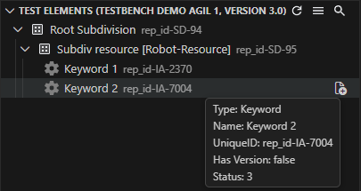
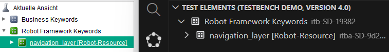
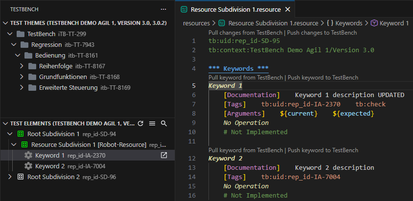

import createResourceWebm from './videos/create_resource.webm';
import createResourceMp4 from './videos/create_resource.mp4';
import syncKeywordsWebm from './videos/sync_keywords.webm';
import syncKeywordsMp4 from './videos/sync_keywords.mp4';

**Test Elements View** shows the resource subdivisions and keywords for the currently opened TestBench context.



## Resource identification and action visibility

Subdivisions with a configured resource marker suffix are treated as Robot Framework resources.

The default resource marker suffix is `[Robot-Resource]` and can be changed with the **resourceMarker** extension setting.



The **Create Resource** and **Open Resource** actions are shown only for subdivisions that match the configured resource marker suffix. **Open in Explorer View** is shown for subdivision folder nodes.

## Create or open resource files

Use **Create Resource** to create a `.resource` file for a resource subdivision. Use **Open Resource** to open an existing `.resource` file for that subdivision. Use **Open in Explorer View** to reveal the related subdivision folder in the VS Code Explorer view.

<video controls preload="metadata" playsinline width="100%">
	<source src={createResourceWebm} type="video/webm" />
	<source src={createResourceMp4} type="video/mp4" />
	Your browser does not support the video tag.
</video>

## Required metadata for synchronization

A resource file is linked to TestBench by metadata at two levels:

- **File level**: two lines at the top of the file, before the first section header, identify the subdivision and the TestBench context.
- **Keyword level**: each synchronized keyword has a `tb:uid:<Keyword-UID>` tag that identifies the TestBench keyword.

```robot
tb:uid:<Subdivision-UID>
tb:context:<Project-Name>/<Test Object Version Name>

*** Keywords ***
My Keyword
    [Tags]    tb:uid:<Keyword-UID>
```

When the extension creates a resource file, it writes this metadata automatically. Example:

```robot
tb:uid:itba-SD-9d23166fb5
tb:context:TestBench Demo/Version 4.0

*** Keywords ***
Select Car
    [Tags]    tb:uid:iTB-IA-5100
    [Arguments]    ${name}
    # Not Implemented
```

The metadata must be kept valid:

- Without the file-level `tb:uid` line, no CodeLens actions are shown for the file. Add the line manually if it is missing.
- If `tb:context` is missing or does not match the active TOV, the file shows a diagnostic. Use the **Quick Fix** action **Apply selected TestBench context** to write the active context into the file, or select the matching TOV in **Projects View**.

## Keyword navigation

Single-clicking a keyword opens the corresponding resource file and jumps to the keyword definition. Double-clicking performs the same action and also reveals the resource file in the VS Code Explorer view.



## Keyword synchronization

CodeLens actions are inline clickable commands shown directly in the editor. Open a resource file with valid metadata to see them.

| CodeLens action                 | Shown                                  | Effect                                                           |
| ------------------------------- | -------------------------------------- | ---------------------------------------------------------------- |
| **Pull changes from TestBench** | At the top of the file                 | Updates all keywords in the file from the TestBench subdivision. |
| **Push changes to TestBench**   | At the top of the file                 | Pushes all keywords in the file to the TestBench subdivision.    |
| **Pull keyword from TestBench** | Above a keyword with a `tb:uid` tag    | Updates this keyword from TestBench.                             |
| **Push keyword to TestBench**   | Above a keyword with a `tb:uid` tag    | Pushes this keyword to TestBench.                                |
| **Create keyword in TestBench** | Above a keyword without a `tb:uid` tag | Creates a new TestBench keyword with this name and interface.    |

### Exclude keywords from synchronization

Keywords tagged with `tb:ignore` or `robot:private` are skipped. No CodeLens actions are shown for them. Use this for local helper keywords that should not exist in TestBench:

```robot
*** Keywords ***
Local Helper
    [Tags]    tb:ignore
    Log    Not synchronized with TestBench
```

### Locked elements

A keyword that is locked in TestBench, for example because another user is editing it, cannot be pushed. Unlock it in TestBench and push again.

<video controls preload="metadata" playsinline width="100%">
	<source src={syncKeywordsWebm} type="video/webm" />
	<source src={syncKeywordsMp4} type="video/mp4" />
	Your browser does not support the video tag.
</video>

## Toolbar buttons

The Test Elements View toolbar provides quick actions for navigation and tree updates:

- **Refresh Test Elements** reloads the current Test Elements context.
- **Open Projects View** switches back to Projects View.
- **Search** filters subdivisions and keywords in the tree.
