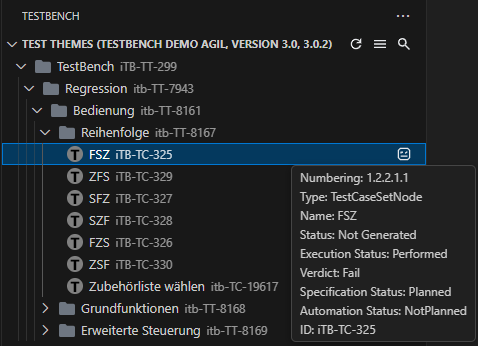
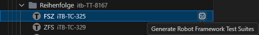
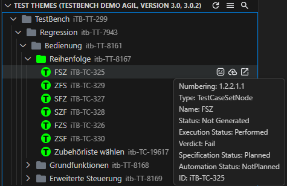
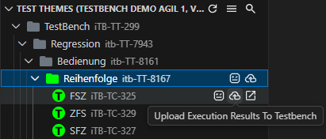
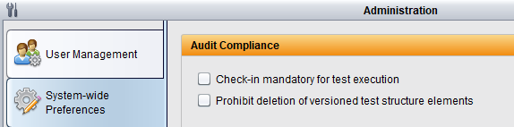
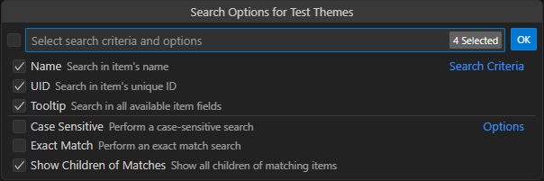

**Test Themes View** is used to generate Robot Framework suites from TestBench structures and to upload execution results back to TestBench.

## Open context

Open a TOV or cycle from **Projects View** to load the corresponding **Test Themes View**. For a complete workflow that includes execution results upload, open a cycle context.

## Generate Robot Framework test suites

Every Test Theme and Test Case Set node has a **Generate Robot Framework Test Suites** action. Running it generates suites for the selected node and its subtree. Generated items are visually marked in the tree.

Test generation uses the bundled `testbench2robotframework` library and is controlled by these settings:

- **outputDirectory** sets the output location (default: `tests`).
- **cleanFilesBeforeTestGeneration** deletes existing files in the output directory before new suites are generated (default: enabled).

:::warning
With **cleanFilesBeforeTestGeneration** enabled, every generation run deletes all files in the output directory. Do not keep hand-written files there.
:::

## Open generated files

Single-clicking a generated test case set opens its `.robot` file. Double-clicking opens the file and also reveals it in the VS Code Explorer view.

## Execute and upload results

Run generated suites with RobotCode or any other Robot Framework runner before uploading results.

Use the tree item action **Upload Execution Results To TestBench** on the node you want to upload. You can upload a selected subtree or a single node.

- The action is available only when **Test Themes View** is opened from a cycle context.
- The action is visible for generated nodes and generated subtree contexts.
- Upload reads the Robot Framework results from the file configured in **outputXmlFilePath** (default: `results/output.xml`, relative to the workspace).
- If no file is found at the configured path, the extension opens a file dialog so that you can select the `output.xml` manually.
- After a successful upload, affected tree items are updated to `Performed` and show verdict details in their tooltips.

### Default behavior after upload

In TestBench, **Check-in mandatory for test execution** is enabled by default. You can find this option in **Administration > System-wide Preferences**.

When this option is enabled, uploading execution results causes TestBench to check in the executed items. The extension shows only executable items that are not locked by the system, so uploaded items are removed from **Test Themes View** after a successful upload.

If **Check-in mandatory for test execution** is disabled in TestBench, uploaded items remain visible in **Test Themes View** after upload.

## Toolbar buttons

The Test Themes View toolbar provides quick actions for navigation and tree updates:

- **Refresh Test Themes** reloads the current Test Themes context.
- **Open Projects View** switches back to Projects View.
- **Search** filters test themes and test case sets in the tree.

